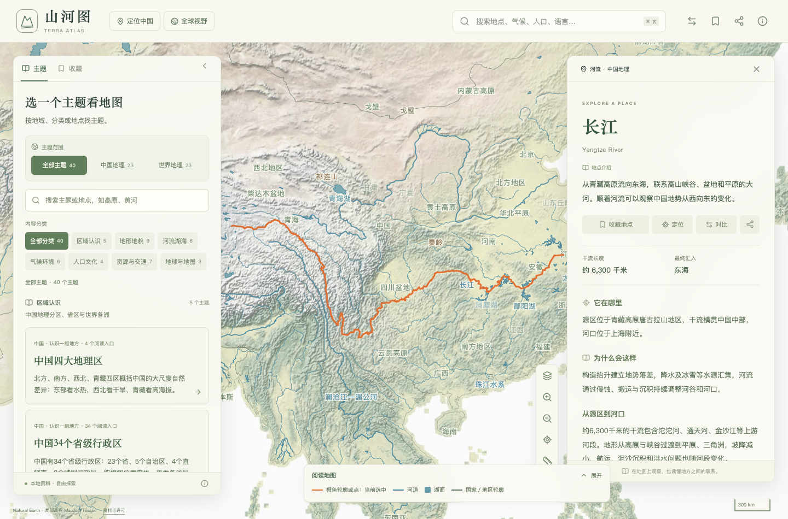

# 山河图 · Terra Atlas

**在地图上自由探索中国与世界地理。**

山河图是一个个人地理学习网站。从山川、河流与国家出发，切换地形、气候、人口、宗教和语言主题，阅读有出处的中文讲解，比较不同地方。首页以自由探索为主，无需按教材或固定顺序学习。

**[在线体验](https://terraatlas.zhaoguhong.com/)** · [数据与来源](docs/data.md) · [部署说明](docs/deployment.md) · [测试说明](docs/testing.md) · [参与贡献](CONTRIBUTING.md) · [许可范围](LICENSE-CONTENT.md)



## 可以怎样探索

- **从地点出发**：搜索“长江”或“阿尔卑斯山”，也可用英文地名查找；点击地图要素，阅读有来源的中文讲解或数据概览。
- **按主题观察**：打开“世界七大洲”比较大陆面积，或切换“长期气候分布”观察气候范围；结合图例理解颜色、数值与资料口径。
- **比较与实验**：比较两地资料、测量球面距离，在地球与地图主题中体验昼长、经度地方时和比例尺实验。
- **收藏与分享**：在浏览器保存收藏和视图，用链接分享当前地图与阅读状态，支持导出和导入记录。
- **手机阅读**：竖屏使用底部阅读面板，横屏使用地图与资料分栏，切换布局时保留阅读位置。

目前收录 **211 张精选知识卡片、40 个主题、122 个学习模块和 30 类气候详细笔记**。未精选编写的地图对象只展示数据概览；这不代表全部地区和课程内容已经覆盖，详见[数据边界](docs/data.md)。

## 本地运行

推荐 **Node.js 24**（见 `.nvmrc`），最低要求 22.12.0。核心地图与已处理数据随项目提供，日常前端开发不需要 Python、业务后端、数据库或地图 API 密钥。在项目根目录执行：

```sh
npm ci
npm run dev
```

打开终端显示的开发地址。地图绘制需要支持 WebGL 的现代浏览器；首次加载速度取决于网络与设备。生产构建与预览：

```sh
npm run build
npm run preview -- --port 4176 --strictPort
```

预览地址为 [http://127.0.0.1:4176/](http://127.0.0.1:4176/)。`dist/` 为完整纯静态站点，需要通过 HTTP/HTTPS 访问，不能直接双击 HTML。自有域名、子目录构建与托管方法见[部署说明](docs/deployment.md)。

技术栈：React · TypeScript · Vite · MapLibre GL JS · 普通 CSS。

## 数据来源与使用边界

| 内容 | 来源与范围 |
| --- | --- |
| 自然地理与地形底图 | Natural Earth；河湖和自然区域采用真实源数据并概化，部分区域是标注参考范围 |
| 长期气候 | Beck 等（2023）V3、1991–2020、0.5° Köppen–Geiger，统一使用 A–E 分类 |
| 人口 | JRC GHS-POP R2023A，2020；真实人口求和聚合至 0.5° |
| 语言 | Glottolog 5.3 参考点、Glottography v2.0 的 2007 年图集参考区域 |
| 国家资料 | 固定历史资料与世界银行 WDI，逐项保留年份和统计口径 |
| 辅助图层与局部高程 | Natural Earth 城市、BasinATLAS 流域、USGS 板块边界及 Mapzen/Tilezen 局部高程，分别保留来源与许可 |

精选讲解为核对资料后的原创中文概述，附可核对来源；自然区域、语言范围和国家资料都存在尺度、时期与覆盖限制。地图用于学习和区域比较，不用于导航、精确测量或判断边界。完整版本、许可、处理说明及校验记录见[数据文档](docs/data.md)与[第三方声明](THIRD_PARTY_NOTICES.md)。

默认自然地图与知识从本站加载。可选“详细地图”和“三维地形”由浏览器按视野访问 OpenFreeMap 与 Mapterhorn，需要外部网络；开启时应同时保留对应署名。收藏与偏好只存于当前浏览器，不上传服务器；清理站点数据会移除这些记录，重要记录请先导出备份。

## 检查与贡献

```sh
npm run data:check
npm test
npm run build
npx playwright install chromium
npm run test:e2e:smoke
```

冒烟测试自动启动生产预览，检查桌面／手机的真实地图绘制与关键操作。完整交互回归和子目录检查见[测试说明](docs/testing.md)。GitHub Actions 配置执行数据校验、单元测试、构建及根路径／子目录冒烟测试；具体运行结果以实际报告为准。

欢迎报告程序问题、提供可靠地理来源或改善交互，见[贡献指南](CONTRIBUTING.md)。地理数据重建是可选维护流程，日常开发无需原始缓存。

## 许可

- **项目拥有权利的代码、脚本及开发文档**：[MIT](LICENSE)。
- **原创地理讲解**：[CC BY 4.0](LICENSES/CC-BY-4.0.txt)，允许商用，分享时须署名、保留许可并注明修改。
- **第三方数据、依赖与材料**：分别保留原条件，见[第三方声明](THIRD_PARTY_NOTICES.md)。

流域图层从官方 BasinATLAS v1.0 重新生成，派生数据采用 CC BY 4.0，保留原作者署名及本项目修改说明。详细范围和署名示例见[许可说明](LICENSE-CONTENT.md)。
