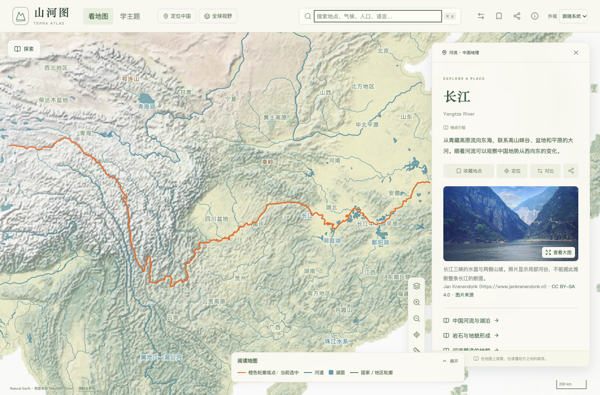

# 山河图 · Terra Atlas

山河图是一本可以在地图上读的中文地理图册。你可以沿长江从青藏高原一路看到入海口，也可以翻开一篇专题，读到桂林峰林时，再回到地图上找漓江。

**[打开地图](https://terraatlas.zhaoguhong.com/)** · **[浏览 30 个图文专题](https://terraatlas.zhaoguhong.com/topics/)**



<details>
<summary>查看手机专题阅读</summary>


</details>

## 在图册里可以看什么

在「看地图」里搜“长江”，点选河道就能读到它的知识卡片。想把一条河放回更大的地理环境里看，可以打开流域图层，或从「主题地图」切换到气候、人口和语言分布。地图支持中英文地名搜索、两地比较和距离测量。216 张精选卡片附有讲解和来源，其余地图要素可点开查看数据概览。

「学主题」适合从一个问题读起。比如，雨水渗入石灰岩后，怎样慢慢形成地下水路？在《常见地貌与中国典型景观》的喀斯特章节里，可以对照示意图和实景照片阅读，从桂林案例进入地图，再回到刚才读到的段落。[阅读喀斯特章节](https://terraatlas.zhaoguhong.com/topics/landform-landscapes/#karst)

全站 30 个专题包含 179 个学习模块，另有 30 类气候笔记。80 张配图包括 9 张实景照片、51 张机制图、6 张数据地图和 14 张 AI 辅助插图。比例尺、地方时和昼长等专题实验可以调整参数，观察结果怎样变化。

桌面和手机都可以收藏地点、保存地图视图或分享具体章节。收藏与阅读进度保存在当前浏览器，清理站点数据前可先导出备份。外观可跟随系统，也可手动切换日间或夜间模式。

## 本地运行

开发使用 **Node.js 24**（见 `.nvmrc`）。在仓库根目录运行以下命令，然后用支持 WebGL 的现代浏览器打开终端显示的地址。

```sh
npm ci
npm run dev
```

地图、图文和处理好的地理数据随仓库提供，日常开发无需下载原始数据。要预览生产版本，运行以下命令。

```sh
npm run build
npm run preview -- --port 4176 --strictPort
```

预览地址为 [http://127.0.0.1:4176/](http://127.0.0.1:4176/)。`dist/` 是完整的静态站点，通过 HTTP 或 HTTPS 提供访问。自有域名、子目录构建和托管方法见[部署说明](docs/deployment.md)。

前端使用 React、TypeScript、Vite、MapLibre GL JS 和普通 CSS。生产构建为每篇专题生成独立 HTML，直接打开文章就能阅读，进入地图时才加载地图引擎。[加载与体积](docs/performance.md)

## 数据来源与使用边界

| 内容 | 来源与范围 |
| --- | --- |
| 自然地理与地形底图 | Natural Earth；河湖和自然区域采用真实源数据并概化，部分区域是标注参考范围 |
| 长期气候 | Beck 等（2023）V3、1991–2020、0.5° Köppen–Geiger，统一使用 A–E 分类 |
| 人口 | JRC GHS-POP R2023A，2020；真实人口求和聚合至 0.5° |
| 宗教 | 公开历史国家资料，逐项注明年份、统计口径和人口分母 |
| 语言 | CLDR 48 国家主要通用语言概览；Glottolog 5.3 参考点、Glottography v2.0 的 2007 年图集参考区域 |
| 国家资料 | 固定历史资料与世界银行 WDI，逐项保留年份和统计口径 |
| 辅助图层与局部高程 | Natural Earth 城市、BasinATLAS 流域、USGS 板块边界及 Mapzen/Tilezen 局部高程，分别保留来源与许可 |

地图按全球和区域尺度概化，供地理学习和区域比较。自然区域、语言范围和国家资料各有尺度、时期和覆盖限制。完整版本、许可、处理说明和校验记录见[数据文档](docs/data.md)与[第三方声明](THIRD_PARTY_NOTICES.md)。

默认底图、知识卡片和专题配图由本站提供。开启“详细地图”或“三维地形”时，浏览器会按视野向 OpenFreeMap 或 Mapterhorn 请求瓦片，地图上会显示对应署名。

## 检查与贡献

```sh
npm run data:check
npm test
npm run build
npx playwright install chromium
npm run test:e2e:smoke
```

冒烟测试会启动生产预览，检查桌面和手机视口中的地图绘制、搜索、专题阅读与分享。GitHub Actions 同时检查根路径和子目录构建。完整交互回归与子目录检查方法见[测试说明](docs/testing.md)。

欢迎报告程序问题、补充可靠的地理来源或改善交互。维护专题文字时，按写作约定编辑原稿，再运行 `npm run reading:build` 生成站点内容。[贡献指南](CONTRIBUTING.md) · [专题写作约定](docs/writing.md)

## 许可

- 项目有权授权的**代码、脚本和开发文档**采用 [MIT](LICENSE)。
- 项目有权授权的**原创地理讲解与教学示意图**采用 [CC BY 4.0](LICENSES/CC-BY-4.0.txt)。分享时须署名、保留许可并注明修改。
- **第三方数据、依赖和照片**各自保留原许可与署名。照片可逐张查询。[第三方声明](THIRD_PARTY_NOTICES.md) · [照片署名](public/licenses/reading-images.txt)

流域图层从官方 BasinATLAS v1.0 重新生成，派生数据采用 CC BY 4.0，保留原作者署名及本项目修改说明。详细范围和署名示例见[许可说明](LICENSE-CONTENT.md)。
