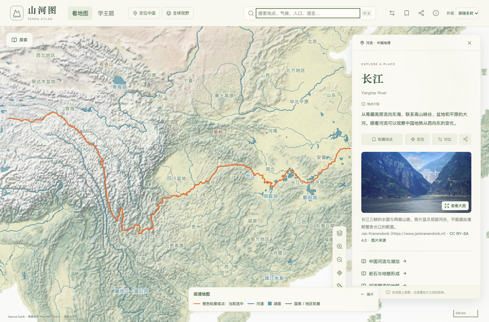

# 山河图 · Terra Atlas

山河图是一座可以自由探索的中文地理图册。沿长江看高原、盆地与入海口，或者切换气候、人口、宗教和语言图层，比较中国与世界各地。

**[在线体验](https://terraatlas.zhaoguhong.com/)**



<details>
<summary>查看手机专题阅读</summary>


</details>

## 看地图与学主题

- **看地图**支持中英文地名搜索。试着搜“长江”或“阿尔卑斯山”，点开地点读知识卡片。也可以从“主题地图”选择一个主题，观察图层与地点案例。
- **学主题**可以按章节读完整图文。例如在喀斯特专题里看溶洞形成示意和桂林实景，从案例跳到地图，再回到原来的阅读位置。
- **比较与实验**包括两地资料对照和球面距离测量。“读地图与影像”和地球相关专题还提供比例尺、地方时和昼长实验。
- **收藏与分享**支持收藏地点与专题、继续上次阅读、保存地图视图，以及分享具体章节。探索记录可以导出和导入。

地图和专题阅读均适配桌面与手机。外观默认跟随系统，可在“外观”中切换日间和夜间模式。

目前收录 **216 张精选知识卡片、32 个图文专题、193 个学习模块和 30 类气候笔记**，配有 9 张实景照片，以及 50 幅示意图和专题地图。其余地图对象提供数据概览。各主题的来源与覆盖范围见[数据文档](docs/data.md)。

## 本地运行

使用 **Node.js 24**（见 `.nvmrc`，最低为 22.12.0）和支持 WebGL 的现代浏览器。在项目根目录运行以下命令。

```sh
npm ci
npm run dev
```

打开终端显示的地址即可。地图和已处理的数据随仓库提供，前端可独立运行。

以下命令用于生产构建和预览。

```sh
npm run build
npm run preview -- --port 4176 --strictPort
```

预览地址为 [http://127.0.0.1:4176/](http://127.0.0.1:4176/)。`dist/` 是完整的静态站点，通过 HTTP 或 HTTPS 提供访问。自有域名、子目录构建和托管方法见[部署说明](docs/deployment.md)。

项目使用 React、TypeScript、Vite、MapLibre GL JS 和普通 CSS。

## 数据来源与使用边界

| 内容 | 来源与范围 |
| --- | --- |
| 自然地理与地形底图 | Natural Earth；河湖和自然区域采用真实源数据并概化，部分区域是标注参考范围 |
| 长期气候 | Beck 等（2023）V3、1991–2020、0.5° Köppen–Geiger，统一使用 A–E 分类 |
| 人口 | JRC GHS-POP R2023A，2020；真实人口求和聚合至 0.5° |
| 宗教 | 公开历史国家资料，逐项注明年份、统计口径和人口分母 |
| 语言 | CLDR 48 国家主要通用语言概览；Glottolog 5.3 参考点、Glottography v2.0 的 2007 年图集参考区域 |
| 国家资料 | 固定历史资料与世界银行 WDI，逐项保留年份和统计口径 |
| 辅助图层与局部高程 | Natural Earth 城市、BasinATLAS 流域、USGS 板块边界及 Mapzen/Tilezen 局部高程，分别保留来源与许可 |

地图按全球和区域尺度概化，供地理学习和区域比较。自然区域、语言范围和国家资料各有尺度、时期和覆盖限制。完整版本、许可、处理说明和校验记录见[数据文档](docs/data.md)与[第三方声明](THIRD_PARTY_NOTICES.md)。

默认底图、知识卡片和专题配图由本站提供。开启“详细地图”或“三维地形”时，浏览器会按视野向 OpenFreeMap 或 Mapterhorn 请求瓦片，地图上会显示对应署名。

收藏、阅读进度、保存的视图和外观偏好只保存在当前浏览器。清理站点数据会移除这些记录，可通过导出文件备份。

## 检查与贡献

```sh
npm run data:check
npm test
npm run build
npx playwright install chromium
npm run test:e2e:smoke
```

冒烟测试会启动生产预览，检查桌面和手机视口中的地图绘制、搜索、专题阅读与分享。GitHub Actions 同时检查根路径和子目录构建。完整交互回归与子目录检查方法见[测试说明](docs/testing.md)。

欢迎报告程序问题、补充可靠的地理来源或改善交互。维护专题文字时，按写作约定编辑原稿，再运行 `npm run reading:build` 生成站点内容。[贡献指南](CONTRIBUTING.md) · [专题写作约定](docs/writing.md)

## 许可

- 项目有权授权的**代码、脚本和开发文档**采用 [MIT](LICENSE)。
- 项目有权授权的**原创地理讲解与教学示意图**采用 [CC BY 4.0](LICENSES/CC-BY-4.0.txt)。分享时须署名、保留许可并注明修改。
- **第三方数据、依赖和照片**各自保留原许可与署名。照片可逐张查询。[第三方声明](THIRD_PARTY_NOTICES.md) · [照片署名](public/licenses/reading-images.txt)

流域图层从官方 BasinATLAS v1.0 重新生成，派生数据采用 CC BY 4.0，保留原作者署名及本项目修改说明。详细范围和署名示例见[许可说明](LICENSE-CONTENT.md)。
